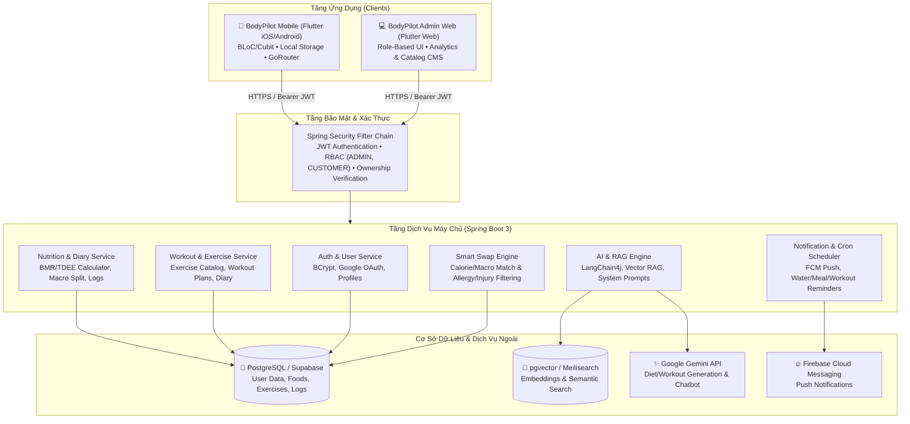

# 🏋️‍♂️ BodyPilot — AI-Powered Personalized Fitness & Nutrition Platform

## 📌 Tổng Quan (Overview)

**BodyPilot** là nền tảng số toàn diện hỗ trợ người dùng xây dựng, theo dõi và tối ưu hóa chế độ dinh dưỡng và lộ trình tập luyện cá nhân hóa. Kết hợp giữa khoa học thể hình, y tế dự phòng và trí tuệ nhân tạo thế hệ mới (**Generative AI & Vector RAG**), BodyPilot mang lại trải nghiệm như một huấn luyện viên cá nhân và chuyên gia dinh dưỡng ảo 24/7.

Hệ thống được thiết kế theo kiến trúc **Monorepo** gồm 3 phân hệ chính:
- **`backend`**: Máy chủ API hiệu năng cao xây dựng trên nền tảng **Spring Boot 3 (Java 17)**, tích hợp **Spring Security 6**, **PostgreSQL / pgvector**, **LangChain4j**, **Google Gemini** và **Firebase Cloud Messaging**.
- **`mobile`**: Ứng dụng di động **Flutter** (iOS & Android) với kiến trúc BLoC/Cubit, giao diện trực quan, hỗ trợ theo dõi chỉ số, nhật ký dinh dưỡng/tập luyện, đếm bước chân và trợ lý ảo AI.
- **`admin_web`**: Trang quản trị **Flutter Web** dành riêng cho Quản trị viên (`ADMIN`) để quản lý danh mục thực phẩm, bài tập, hồ sơ người dùng và giám sát chất lượng phản hồi AI.
- **`core_shared`**: Gói thư viện chia sẻ định nghĩa Data Models, DTOs và Enums đồng bộ giữa Mobile và Web.

---

## 🏗️ Kiến Trúc Hệ Thống (Architecture)



---

## 🚀 Tính Năng Chính (Key Features)

### 1. Khảo Sát & Đánh Giá Thể Trạng Cá Nhân Hóa (Assessment)
- Tính toán chính xác **BMR** (Basal Metabolic Rate) và **TDEE** (Total Daily Energy Expenditure) dựa trên tuổi, giới tính, chiều cao, cân nặng và mức độ vận động.
- Xác định mục tiêu: *Giảm cân*, *Tăng cơ*, *Duy trì vóc dáng* và tự động tính toán tỷ lệ phân bổ dinh dưỡng (Protein, Carbs, Fat).
- Ghi nhận tiền sử bệnh lý nền, chấn thương cơ xương khớp, các loại thực phẩm gây dị ứng và thói quen ăn uống (Ăn chay, Keto, Low-Carb, v.v.).

### 2. Gợi Ý Thực Đơn & Lịch Tập Thông Minh Bằng AI (AI Diet & Workout Engine)
- Sinh kế hoạch bữa ăn nhiều ngày tự động phù hợp với ngân sách calo và khẩu vị, tuân thủ nghiêm ngặt danh sách dị ứng.
- Lên lịch tập luyện phù hợp với thể trạng và tránh kích hoạt các nhóm cơ đang gặp chấn thương.
- Cơ chế Fallback an toàn tự động kích hoạt tạo thực đơn từ kho dữ liệu chuẩn khi dịch vụ AI gặp sự cố.

### 3. Đổi Món & Đổi Bài Tập Thông Minh (Smart Swap)
- Thuật toán tìm kiếm các món ăn hoặc bài tập thay thế tương đương về Calo/Macro và nhóm cơ.
- Bộ lọc an toàn loại bỏ triệt để các thực phẩm nằm trong danh mục dị ứng hoặc ghi chú dị ứng cá nhân.

### 4. Trợ Lý Thể Hình AI 24/7 (Fitness AI Assistant - RAG)
- Trò chuyện tự nhiên giải đáp mọi thắc mắc về kỹ thuật động tác, dinh dưỡng và lối sống lành mạnh.
- Tích hợp kỹ thuật **Retrieval-Augmented Generation (RAG)** đối chiếu kiến thức y khoa thể thao và hồ sơ sức khỏe cá nhân của người dùng.
- Cơ chế tự động dọn dẹp lịch sử hội thoại quá hạn (TTL 7 ngày) trên thiết bị nhằm bảo đảm quyền riêng tư.

### 5. Nhật Ký Dinh Dưỡng & Tập Luyện (Nutrition & Workout Diary)
- Ghi chép chi tiết lượng thức ăn từng bữa chính (Sáng, Trưa, Tối) và trạng thái hoàn thành.
- Nhật ký tập luyện chi tiết từng bài tập, số hiệp (sets), số lần lặp (reps), mức tạ (kg) và thời gian nghỉ.
- Sao chép nhanh thực đơn/lịch tập giữa các ngày chỉ với 1 chạm.

### 6. Theo Dõi Bước Chân & Điểm Danh (Step Tracker & Daily Check-in)
- Tích hợp cảm biến đếm bước chân trên thiết bị và đồng bộ chỉ số tiêu hao calo vận động.
- Điểm danh chuỗi ngày liên tục (**Streak Counter**) tạo động lực duy trì thói quen tập luyện.

### 7. Hệ Thống Thông Báo Đẩy (FCM Push Notifications)
- Nhắc nhở thông minh theo chu kỳ sinh học: Uống nước, dùng bữa đúng giờ, giờ tập luyện và tổng kết ngày.
- Bộ lọc danh mục thông báo và điều hướng màn hình an toàn.

### 8. Trang Quản Trị Quản Lý (Admin Portal)
- Thống kê tổng quan người dùng hoạt động, tăng trưởng và chỉ số hệ thống.
- Quản lý danh mục món ăn, nguyên liệu, bài tập và lịch trình tập mẫu.
- Giám sát nhật ký đánh giá chất lượng phản hồi của mô hình AI (AI Evaluation telemetry).

---

## 🛠️ Công Nghệ Sử Dụng (Tech Stack)

| Phân Hệ | Công Nghệ & Thư Viện Chính |
|---|---|
| **Backend** | • Java 17, Spring Boot 3.4+<br/>• Spring Security 6 (JWT, RBAC, IDOR Protection)<br/>• Spring Data JPA, Hibernate, PostgreSQL, pgvector<br/>• LangChain4j, Google Generative AI (Gemini Flash)<br/>• Firebase Admin SDK (FCM) |
| **Mobile** | • Flutter 3.x, Dart<br/>• State Management: `flutter_bloc` (BLoC / Cubit)<br/>• Navigation: `go_router`<br/>• Local Storage: `shared_preferences`, `hive_flutter`, `sqflite`<br/>• Networking: `dio` with Interceptors & Connectivity guards |
| **Admin Web** | • Flutter Web<br/>• State Management: `flutter_bloc`<br/>• UI / Charts: `fl_chart`, `lucide_icons_flutter`, Google Fonts<br/>• Networking: `dio` with Bearer token authentication |
| **Shared** | • `core_shared`: Gói thư viện chia sẻ dùng chung các Data Models & DTOs |

---

## 📁 Cấu Trúc Dự Án (Project Structure)

```
BodyPilot/
├── backend/                       # Máy chủ API Spring Boot 3
│   ├── src/main/java/com/bodypilot/backend/
│   │   ├── config/                # Cấu hình Spring Security, CORS, LangChain4j, Firebase
│   │   ├── controller/            # REST API Controllers (Auth, Users, Foods, Exercises, Diary, AI...)
│   │   ├── exception/             # Xử lý lỗi tập trung GlobalExceptionHandler
│   │   ├── model/                 # Entities (JPA), DTOs, Enums
│   │   ├── rag/                   # Cấu hình Vector Store & FitnessAiAssistant
│   │   ├── repository/            # Spring Data JPA Repositories
│   │   ├── security/              # JwtService, JwtAuthFilter, UserSecurity
│   │   └── service/               # Nghiệp vụ (Diet, Workout, AI, FCM, SmartSwap...)
│   ├── src/main/resources/        # application.properties, prompts, migration SQL
│   └── pom.xml                    # Maven dependencies & plugins
│
├── mobile/                        # Ứng dụng di động Flutter
│   ├── lib/
│   │   ├── core/                  # Network ApiClient, Route pages, Theme, Utilities
│   │   ├── data/                  # Repositories, Local Services (TokenService, Hive)
│   │   └── presentation/          # BLoC/Cubit, Màn hình giao diện (Screens) & Widgets
│   └── pubspec.yaml               # Thư viện & tài nguyên Mobile
│
├── admin_web/                     # Trang quản trị Flutter Web
│   ├── lib/
│   │   ├── core/                  # ApiClient (gắn Bearer JWT tự động)
│   │   ├── data/                  # Admin & Catalog Repositories
│   │   ├── logic/                 # Cubits quản lý trạng thái Admin
│   │   └── presentation/          # Màn hình Dashboard, Catalog CMS, AI Eval Logs
│   └── pubspec.yaml               # Thư viện & tài nguyên Web
│
├── core_shared/                   # Thư viện Dart dùng chung giữa Mobile & Admin Web
│   ├── lib/models/                # User, Food, Exercise, Diary, Goal models
│   └── pubspec.yaml
│
├── data/                          # Dữ liệu mẫu thực phẩm, dinh dưỡng & bài tập
├── docs/                          # Tài liệu kỹ thuật, sơ đồ kiến trúc
├── render.yaml                    # Cấu hình triển khai Cloud Render
└── README.md                      # Tài liệu hướng dẫn dự án
```

---

## ⚙️ Hướng Dẫn Cài Đặt & Khởi Chạy (Getting Started)

### 1. Yêu Cầu Môi Trường (Prerequisites)
- **Java**: JDK 17 trở lên
- **Maven**: 3.8+ (hoặc dùng `./mvnw` có sẵn trong thư mục `backend`)
- **Flutter SDK**: 3.10 trở lên
- **Cơ sở dữ liệu**: PostgreSQL 15+ trên **Supabase** (hỗ trợ tiện ích mở rộng `pgvector`) hoặc PostgreSQL cục bộ
- **Google Cloud Console**: Khóa API Gemini & Web Client ID (Google OAuth)
- **Firebase Project**: Tệp tài khoản dịch vụ `firebase-service-account.json`

---

### 2. Cấu Hình & Khởi Chạy Backend

1. **Cấu hình biến môi trường**:
   Backend sử dụng biến môi trường để bảo vệ các thông tin bí mật. Bạn có thể thiết lập trên hệ điều hành, IDE Run Configuration hoặc qua file `.env`:

   ```bash
   # Cổng dịch vụ
   PORT=8080

   # Khóa bảo mật JWT (Khóa HMAC-SHA 256-bit dạng Base64)
   JWT_SECRET_KEY=YOUR_BASE64_256_BIT_SECRET_KEY

   # Cơ sở dữ liệu PostgreSQL (Supabase / Local)
   # Ví dụ với Supabase Transaction Pooler:
   SPRING_SOURCE_URL=jdbc:postgresql://aws-0-ap-southeast-1.pooler.supabase.com:6543/postgres?sslmode=require
   # Hoặc chạy Local: jdbc:postgresql://localhost:5432/bodypilot?sslmode=disable
   SPRING_DATASOURCE_USERNAME=postgres.your_supabase_ref
   SPRING_DATASOURCE_PASSWORD=your_database_password

   # Khóa Google Gemini API
   GEMINI_API_KEY=AIzaSy...your_gemini_api_key

   # Google OAuth Client ID (dùng cho đăng nhập Google)
   GOOGLE_CLIENT_ID=your_google_client_id.apps.googleusercontent.com

   # Đường dẫn tệp khóa Firebase Service Account (nếu có push notification)
   FIREBASE_CONFIG_PATH=file:secrets/firebase-service-account.json
   ```

2. **Khởi chạy ứng dụng**:
   ```bash
   cd backend
   # Trên Windows:
   .\mvnw.cmd spring-boot:run

   # Trên Linux/macOS:
   ./mvnw spring-boot:run
   ```

3. **Kiểm tra trạng thái**:
   - Truy cập kiểm tra API Health: `http://localhost:8080/api/v1/auth/health`
   - Tài liệu OpenAPI / Swagger: `http://localhost:8080/swagger-ui/index.html`

---

### 3. Khởi Chạy Mobile App (Flutter)

1. Di chuyển vào thư mục `mobile`:
   ```bash
   cd mobile
   flutter pub get
   ```

2. Chọn cấu hình Server URL trong file `lib/core/network/api_client.dart` phù hợp với môi trường thử nghiệm:
   - Máy ảo Android: `http://10.0.2.2:8080/api/v1`
   - Máy thật chung Wi-Fi: `http://<IP_LAN_MAY_TINH>:8080/api/v1`
   - Máy ảo iOS / Web: `http://localhost:8080/api/v1`

3. Chạy ứng dụng trên thiết bị / máy ảo:
   ```bash
   flutter run
   ```

---

### 4. Khởi Chạy Trang Quản Trị Admin Web

1. Di chuyển vào thư mục `admin_web`:
   ```bash
   cd admin_web
   flutter pub get
   ```

2. Chạy trên trình duyệt Chrome:
   ```bash
   flutter run -d chrome
   ```
   > **Lưu ý**: Đăng nhập bằng tài khoản có quyền Quản trị viên (`role = 'ADMIN'`).

---

## 🔒 Bảo Mật (Security)

Hệ thống đã được kiểm toán bảo mật và áp dụng các cơ chế phòng thủ:
- **Kiểm soát truy cập & IDOR**: Xác thực quyền sở hữu trên toàn bộ API dữ liệu cá nhân (`/api/v1/users/{userId}/**`) và phân tách nghiêm ngặt giữa `ROLE_ADMIN` và `ROLE_CUSTOMER`.
- **Bảo mật bí mật**: Tách biệt hoàn toàn credentials, JWT secret, DB password và API keys ra khỏi mã nguồn thông qua biến môi trường.
- **An toàn client**: Giới hạn lưu trữ cục bộ và tự động xóa dữ liệu/chat cache khi đăng xuất hoặc đổi tài khoản.
